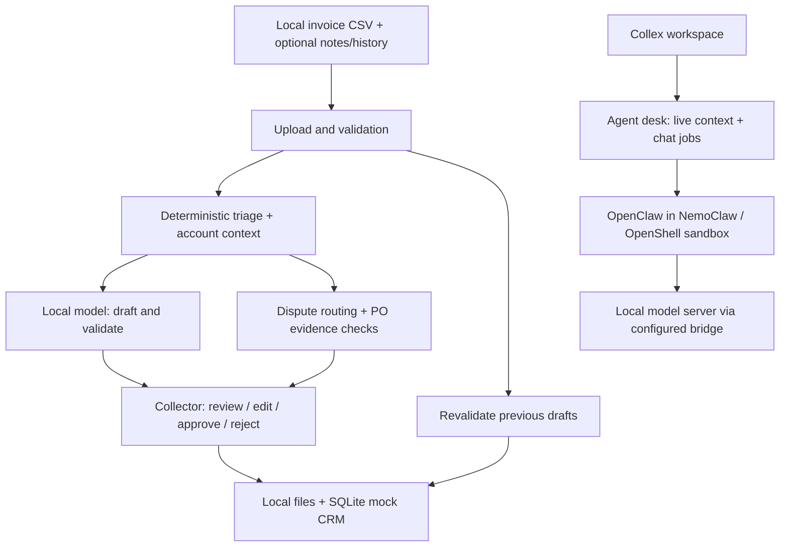

# Collex

### Small invoices. Real work. Local AI.

Collex works the small-balance collections backlog: find neglected invoices, prepare follow-ups, track payment blockers, and give collectors an evidence-backed decision to review. Inference stays on your machine.

Built for the [Dell x NVIDIA AI Hackathon, San Francisco](https://luma.com/builde-ixyz), targeting the **Dell Pro Max with GB10** and **NemoClaw, OpenClaw, and OpenShell**.

[Demo walkthrough](docs/DEMO.md) · [Run locally](#run-locally) · [Architecture](#architecture) · [GB10 deployment](gb10/platform/NEMOCLAW.md)

## Why this exists

A $40 invoice can require the same context gathering as a $40,000 invoice. Collections teams prioritize the larger balance. Smaller invoices accumulate while distributed collectors and onsite finance teams reconcile exports, notes, message history, and handoffs across time zones.

Collex gives that neglected work a dedicated workflow. It prepares routine small-balance actions and routes exceptions to people, letting collectors spend their attention on larger balances and complex customer conversations.

**Why buy instead of build?** Finance engineering can build collections tools, but higher-value projects compete for the same capacity. The commercial proposition is a locally deployed small-balance workflow with policy controls and review built in. This is the buyer hypothesis; the prototype does not establish customer adoption or measured cash recovery.

## What a collector can do

| Workflow | What Collex does |
|---|---|
| Import a portfolio | Upload thousands of invoice rows with optional notes and exported message history. Inspect each eligibility filter's results. |
| Find neglected balances | Apply deterministic overdue, last-touch, and balance rules. The latest touch across sources wins. |
| Coordinate across the account | Group invoices by customer and flag small balances alongside a recently managed large invoice. |
| Prepare follow-ups | Use a local model to draft a customer message, internal note, and mock Salesforce case. Validate fields and label template fallbacks. |
| Work a missing-PO case | Track owner responses and check PO account, amount, expiry, and invoice coverage before preparing a corrected package. |
| Review decisions | Inspect evidence, edit, approve, or reject. Tiny write-offs carry policy and aggregate account controls. |
| Recheck changed facts | Withdraw outdated drafts after payment, changed balance/contact, disputes, or newer human touches. |
| Ask about the work | Use companion chat with live desk context through OpenClaw in the configured sandbox; inspect recent activity. |

**Human approval remains a boundary:** the demo records local decisions and mock CRM cases. It does not send customer emails, post a real accounting write-off, or prove payment was collected.

## A reproducible 20,000-invoice world

The root fixture is synthetic, generated with seed 42 and snapshot date **2026-10-25**. With the committed policy:

| Baseline result | Count |
|---|---:|
| Invoices evaluated | 20,000 |
| Queued invoices | 5,332 |
| Routine collection follow-ups | 4,180 |
| Write-off candidates | 391 |
| Disputes routed for review | 761 |
| Account work packages | 1,071 |

Reproduce with `python triage/triage.py`; inspect `out/queue.json` and `out/headline.json`. These are eligibility results, not 5,332 model-generated drafts. The configured six minutes per touch is a planning assumption, not measured time saved.

A [second 20,000-invoice fixture](data/batches/role-b-20000/README.md) uses distinct IDs and its own schema. The upload adapter accepts that Role B layout. Its original triage totals come from the GB10 implementation and should not be substituted for root-pipeline results.

## Architecture



Rules decide eligibility and calculate financial facts; the model writes language. Validation checks required facts and unsupported amounts, retries failing fields, and records template fallbacks. State, evidence, and decisions stay inspectable on disk.

| Layer | Implementation |
|---|---|
| Workspace | Local HTML/CSS/JavaScript served by Python; no frontend build required |
| Data and workflow | Python 3.10+ standard library; CSV/JSON inputs and outputs |
| Model serving | Local OpenAI-compatible endpoint, such as Ollama |
| Agent runtime | OpenClaw inside the configured NemoClaw/OpenShell sandbox |
| Approval records | Local files and SQLite mock Salesforce cases |

## Run locally

### 1. Prepare the runtime

You need **Python 3.10+**, the repository, and a running local model server with the selected model downloaded. The core Python application requires no pip installation. PyYAML is optional; the policy reader has a fallback.

Full sandbox chat also needs **Docker, NemoClaw, OpenShell, OpenClaw, the collections skill, and model/API access from the sandbox**. Starting the web UI does not provision these. Follow the [GB10 integration notes](gb10/platform/NEMOCLAW.md) for the sandbox, relay, permissions, and known issues.

**Model selection:** set `MODEL_NAME` and `MODEL_BASE_URL` in `platform/model.env`, or override them in the process environment. Use the exact locally served identifier from `ollama list`, including for your chosen DeepSeek model. The checked-in Qwen default and older GPT-OSS notes do not establish the current model on a team's box.

```dotenv
MODEL_BASE_URL=http://127.0.0.1:11434/v1
MODEL_NAME=your-installed-model-tag
```

Replace the tag before running. Drafting reads these settings. Sandbox chat uses the provider/model configured **inside OpenClaw**; `FT_AGENT_MODEL` labels the desk's model but does not switch that provider. Configure and test both paths.

### 2. Build the queue

Run from the repository root. Use `python3` instead of `python` if required by your installation.

```bash
python triage/triage.py
python disputes/disputes.py
python agent/actions.py --limit 3
```

The committed fixture is ready to use. `python data/generate.py` regenerates it when needed. Three drafts are a startup sample, not the entire queue.

### 3. Start the services

Open a terminal for each process, all from the repository root. These ports match the integrated GB10 layout and avoid OpenShell's gateway on 8080.

```bash
# Terminal 1: approvals and uploads
python channel/dashboard.py --host 127.0.0.1 --port 8092
```

```bash
# Terminal 2: agent desk (sandbox must already be configured)
python channel/agent_desk.py --host 127.0.0.1 --port 8091
```

```bash
# Terminal 3: collector workspace
python app/server.py --host 127.0.0.1 --port 8090 --approvals-port 8092
```

Open **http://127.0.0.1:8090**. Uploads open on **http://127.0.0.1:8092/upload**. The workspace expects the agent desk on **8091**. Keep the terminals open while recording. The core laptop workflow can run without sandbox chat, but that does not demonstrate the complete hackathon stack.

### 4. Test the upload button

1. Click **Upload export → Choose files**.
2. Select [the three-invoice CSV](data/demo/upload-test/salesforce_invoices.csv).
3. Give the upload a name and click **Upload and run the rules**.
4. Expect **3 received, 2 eligible** under the committed policy and snapshot: $75 and $249 qualify; $1,500 exceeds the agent threshold.

For the 20,000-invoice demo, select the export files in `data/exports/`, then separately the supported files in `data/batches/role-b-20000/`. Select only `salesforce_invoices.csv`, `collector_sheet.csv`, `slack_threads.json`, and `manifest.json`; omit README, validation reports, and output files.

**One CSV row is one invoice. One upload can contain all 20,000 rows.** Matching IDs update previous records. A `kind: full` manifest replaces earlier uploaded bundles; delta bundles merge with the baseline. Two 20,000-row uploads do not automatically produce 40,000 unique active invoices. Read the actual reports.

## Verify it

```bash
# Deterministic tests, triage and dashboard checks; no model generation
python platform/preflight.py --no-model

# Additional workspace ledger tests
python app/test_ledger.py

# Local model check and one real drafting cycle
python platform/preflight.py
```

Full preflight writes demo state and may post notifications if a channel is configured. For the offline demo, leave optional channel credentials unconfigured. The Python offline guard blocks connections leaving the machine during checks; it is not a whole-system firewall or an audit of every sandbox process.

## Local execution and demo boundaries

- Download installers, weights, and required container images **before** disconnecting. Copy repo, data, and model assets by external drive or local cable; disconnected runtime needs no cloud LLM.
- Imports, drafts, and mock CRM state live on disk. Notes and message-history files are exports, not live Gmail or Slack connectors.
- Approval does not deliver an email or execute a real write-off. A validated PO is supporting evidence, not payment received.
- All supplied customers and invoices are synthetic. Optional external notifications are outside the zero-network demo.
- Reboot startup configuration is provided, but the GB10 notes leave the reboot test unverified. Test it on the box before claiming it.
- This is a hackathon prototype. Authentication, enterprise identity, production accounting integrations, and deployment hardening require further work.

## Explore the repository

| Path | Purpose |
|---|---|
| [app/](app/) | Invoice workspace, APIs, companion presentation |
| [triage/](triage/) | Eligibility, account context, write-off controls, revalidation |
| [agent/](agent/) | Prompts, drafting, validation, mock CRM, uploads |
| [disputes/](disputes/) | Dispute evidence, owner routing, persistent PO cases |
| [channel/](channel/) | Approvals, sandbox chat desk, optional notifications |
| [platform/](platform/) | Checks, offline guard, cycle runner, deployment |
| [data/](data/) | Synthetic exports, generators, fixtures |
| [gb10/](gb10/) | Box integration and earlier parallel implementation |

The **root application** is the integrated workspace; `gb10/` also contains an earlier implementation with different schemas and commands. Use its platform notes for the box; do not mix queue outputs without the adapter.

## Judge walkthrough

See [the 1:55 demo plan](docs/DEMO.md): upload → queue → account context → PO blocker → approve → withdraw an outdated draft → disconnected GB10 proof.

| Event criterion | Evidence to inspect |
|---|---|
| Technical execution | Deterministic tests, draft validation, PO checks, persisted review state, withdrawal |
| Business value | Dedicated small-balance workflow with oversight and account coordination |
| Local-first design | Local inference, file/SQLite state, self-contained UI, disconnected-box demo |
| Demo quality | Visible imports, traceable IDs, readable before/after states, synthetic-data labels |

More detail: [implementation reference](docs/IMPLEMENTATION.md), [drafting and approval](agent/README.md), [offline runbook](platform/RUNBOOK.md), [GB10 sandbox integration](gb10/platform/NEMOCLAW.md).
